# zmk-bb9900

[ZMK](https://zmk.dev) firmware for the [ZitaoTech BB9900 USB/BLE keyboard](https://github.com/ZitaoTech/BB9900-USB_BLE_Keyboard),
built on upstream ZMK and managed with Nix.

The stock firmware runs on a 2024 fork of ZMK that is no longer maintained. This repo replaces
it with a small Zephyr module on top of upstream ZMK, so you can follow new ZMK releases. It
also fixes several problems with the stock firmware.



## What is different from the stock firmware

- **Trackpad.** The ADBS-A320 sensor is now set up the way its datasheet describes, which the
  stock firmware never did:
  - speed switching from 250 to 1250 CPI, tuned from real thumb swipes;
  - noise gating;
  - a liftoff twitch filter;
  - a reset and ID check at boot, with automatic recovery.
  Fine movement is smooth, a screen takes 2–3 swipes to cross, and the trackpad comes up on
  every boot.
- **Scroll mode belongs to the keyboard.** Tap Call to toggle it, or hold Call to scroll while
  held. Scrolling is smooth (high-resolution). It no longer depends on the host's caps lock, so
  you can type while scrolling and it works on every host.
- **Keys do what their labels say.** `alt` is Alt, `aA` is Shift, and `$` types `$`. Shift,
  Ctrl, Alt and the SYM layer are sticky, BlackBerry style: tap applies to the next key, hold
  works as normal. Double-tap `aA` for caps word. Double-tap SYM to lock it.
- **Power.** No more empty mouse reports 100 times a second. The keyboard deep-sleeps after
  2 hours without use, and the indicator lights turn off when idle. The board's charging
  circuit keeps USB power detected even on battery, which stopped deep sleep from ever
  starting; the firmware works around this.
- **ZMK Studio.** Edit the keymap live over USB or Bluetooth at <https://zmk.studio>. Unlock
  with UPPER-E.

## Layout

| Key | Function |
|---|---|
| `aA` (either) | Shift. Tap for one capital, hold for Shift, double-tap for caps word. |
| `alt` | Alt (sticky) |
| `0` | Ctrl (sticky) |
| `SYM` | The legends printed on the keys. Tap for one key, hold, or double-tap to lock. |
| `alt` + `aA` together | Toggle UPPER: Bluetooth, arrows, extra symbols, backlight, system |
| Call | Tap to toggle scroll mode (trackpad backlight on), hold to scroll while held |
| Trackpad press, shoulder keys | Left click, left click, right click |

On UPPER:
- the four big buttons select Bluetooth profiles 0–3; hold one for 2 s to clear that profile
  and pair a new device. Pairing asks for the 6-digit code shown on the host: type it with the
  SYM layer digits (double-tap SYM to lock) and press Enter;
- U toggles USB/BLE output;
- `$` enters the bootloader.

The big-button backlight shows the layer: off on BASE, steady on SYM, breathing on UPPER.

## Building and flashing

You need [Nix](https://nixos.org/download) with flakes enabled.

```sh
nix build            # firmware in ./result/zmk.uf2
nix run .#flash      # waits for the bootloader drive, then copies the firmware
```

To enter the bootloader, connect USB, press `alt` + `aA` (UPPER) and then `$`. You can also
download the firmware from the latest [CI run](../../actions) without installing anything, and
copy `zmk.uf2` to the `NICENANO` drive yourself.

`nix run .#flash-debug` flashes a build that logs over USB serial (`/dev/ttyACM0`). The log
includes trackpad and deep-sleep diagnostics.

## Customising

- **Keymap:** `config/bb9900.keymap`. Run `nix run .#draw` afterwards to update the image above.
  CI checks that it matches.
- **Settings** (sleep, backlight, indicator lights, smooth scrolling): `config/bb9900.conf`.
  Turn off `CONFIG_ZMK_POINTING_SMOOTH_SCROLLING` if you use the keyboard with a Mac or an
  iPhone/iPad, which would otherwise scroll about 16× too fast.
- **Trackpad speed and scroll speed:** see the comments at the bottom of the keymap.

## Updating ZMK

`config/west.yml` pins ZMK to a commit on `main`. A weekly workflow opens a PR that bumps it,
and CI builds the PR. To update by hand:

```sh
nix run .#update
```

## Repository layout

| Path | What it is |
|---|---|
| `boards/zitaotech/bb9900/` | Board definition (Zephyr HWMv2, target `bb9900//zmk`), including the physical layout |
| `drivers/input/input_a320.c` | ADBS-A320 trackpad driver |
| `src/input_processor_scroll_curve.c` | Turns trackpad motion into scrolling on the scroll mode layer |
| `src/layer_indicator.c`, `src/trackpad_indicator.c` | Big-button and trackpad backlights |
| `src/usb_suspend_unplug.c` | Deep sleep workaround for the VBUS back-feed |
| `config/` | Keymap, settings, keymap-drawer config and the west manifest |
| `docs/` | Keymap image and redesign notes |

## Credits

The board definition and the original trackpad and indicator code come from
[ZitaoTech/zmk](https://github.com/ZitaoTech/zmk/tree/bbkeyboard_tp) and
[ZitaoTech/zmk-config_9900](https://github.com/ZitaoTech/zmk-config_9900). Built with
[ZMK](https://zmk.dev), [zmk-nix](https://github.com/lilyinstarlight/zmk-nix) and
[keymap-drawer](https://github.com/caksoylar/keymap-drawer). MIT licensed.
